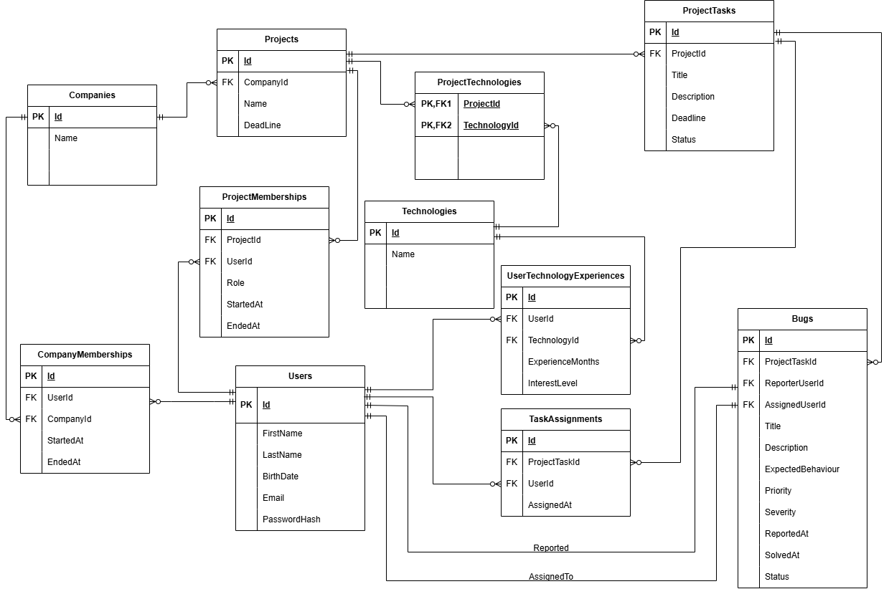

# DevFlow

**A Full-Stack Project Management Application**

DevFlow is a full-stack project management application designed to help teams organize projects, manage tasks, track bugs, and collaborate more efficiently.

The application is being developed with a modern web technology stack, combining an ASP.NET Core Web API backend with an Angular frontend and a Microsoft SQL Server database.

The main goal of DevFlow is to provide a structured environment for managing software development projects, organizing work, and keeping track of project progress.

---

## Table of Contents

- [Overview](#overview)
- [Features](#features)
- [Technology Stack](#technology-stack)
- [Application Architecture](#application-architecture)
- [Backend](#backend)
- [Frontend](#frontend)
- [Database Design](#database-design)
- [Authentication and Security](#authentication-and-security)
- [Getting Started](#getting-started)
- [Project Structure](#project-structure)
- [Development Status](#development-status)

---

## Overview

DevFlow is intended to provide a centralized platform for managing software development projects and coordinating team activities.

Users will be able to work with projects, organize tasks, report and track bugs, and collaborate with other team members.

The application follows a client-server architecture:

- The Angular frontend provides the user interface.
- The ASP.NET Core Web API handles business logic and data processing.
- Microsoft SQL Server stores application data.
- Entity Framework Core handles database operations and object-relational mapping.

The frontend communicates with the backend through RESTful HTTP endpoints.

## Features

The application is designed around the following main features:

### User Authentication
- User registration
- User login
- Password hashing
- JWT-based authentication
- Authenticated API requests

### Project Management
- Project creation and management
- Project information and details
- Project membership management
- Team collaboration

### Task Management
- Task creation and organization
- Task assignment and tracking
- Task status management
- Monitoring project progress

### Bug Tracking
- Bug reporting
- Bug tracking and management
- Bug status monitoring

*Note: Features are being implemented progressively. Refer to the Development Status section for the current implementation state.*

---

## Technology Stack

### Backend

| Technology | Purpose |
|---|---|
| C# | Backend programming language |
| ASP.NET Core Web API | REST API development |
| Entity Framework Core | Object-relational mapping |
| Microsoft SQL Server | Relational database |
| JWT | Token-based authentication |
| .NET User Secrets | Secure development configuration |

### Frontend

| Technology | Purpose |
|---|---|
| Angular | Frontend framework |
| TypeScript | Frontend programming language |
| HTML5 | Application structure |
| CSS3 | Styling |
| RxJS | Asynchronous data handling |
| Angular Router | Client-side navigation |
| Angular Signals | Reactive state management |

### Development Tools

- Visual Studio 2026
- Visual Studio Code
- Git
- GitHub
- Node.js
- npm

---

## Application Architecture

DevFlow follows a client-server architecture with a clear separation between the frontend and backend.

```text
          Angular Frontend
                 |
                 | HTTP / REST
                 |
          ASP.NET Core API
                 |
          Application Logic
                 |
         Entity Framework Core
                 |
          SQL Server Database
```

The frontend is responsible for user interaction and presenting application data, while the backend handles validation, business logic, authentication, and database communication.

This separation makes the application easier to maintain, extend, and test.

## Backend

Its primary responsibilities include:

- Exposing RESTful API endpoints.
- Processing incoming HTTP requests.
- Validating application data.
- Handling authentication and authorization.
- Managing application entities.
- Communicating with the SQL Server database through Entity Framework Core.

The API uses dependency injection to manage application services and their dependencies.

### API Error Handling

The backend uses centralized exception handling middleware to provide consistent HTTP error responses.

Expected application errors are mapped to appropriate HTTP status codes, such as:

- `401 Unauthorized` – invalid authentication credentials.
- `409 Conflict` – attempting to register an already existing email address.
- `500 Internal Server Error` – unexpected server-side errors.

Error responses follow the Problem Details format.

## Frontend

The frontend is developed using Angular and TypeScript.

The application uses Angular's standalone component architecture and Angular Router for navigation.

The frontend is responsible for:

- Displaying application data.
- Collecting and validating user input.
- Communicating with the backend API.
- Managing authentication-related state.
- Handling HTTP responses and errors.

Angular HTTP interceptors are used for cross-cutting HTTP functionality, including authentication headers and centralized error observation.

And Auth Guard prevents navigating between pages without a valid token.

Angular Signals are used for reactive state management where appropriate.

## Database Design

The application uses Microsoft SQL Server as its relational database.

Entity Framework Core provides the object-relational mapping layer between the application and the database.

The database schema is managed through Entity Framework Core migrations.

The domain model includes project-related entities and relationships. For example, `ProjectMembership` represents the relationship between projects and their members.

The data model is designed to support project organization, membership management, task tracking, and bug tracking.

### Entity Relationship Diagram

The following diagram illustrates the database schema, including entities, attributes, primary keys, foreign keys, and relationships.




## Authentication and Security

DevFlow uses JSON Web Tokens (JWT) for authentication.

The authentication process follows this general workflow:

1. A user submits their registration or login credentials.
2. The backend validates the submitted information.
3. Passwords are stored using secure password hashing rather than plaintext storage.
4. After successful authentication, the API issues a JWT.
5. The frontend includes the token in the Authorization header of authenticated API requests.
6. The backend validates the token before allowing access to protected endpoints.

Sensitive development configuration, including the JWT signing key, is stored using .NET User Secrets rather than being committed to source control.

---


## Project Structure

The repository is organized into separate backend and frontend applications.

```text
DevFlow/
│
├── Backend/
│   └── DevFlowAPI/
│       └── DevFlowAPI/
│           ├── Controllers/
│           ├── Data/
│           ├── DependenyInjection/
│           ├── DTOs/
│           ├── Exceptions/
│           ├── Middlewares/
│           ├── models/
│           ├── Services/
│           ├── Migrations/
│           ├── Program.cs
│           └── appsettings.json
│
├── Frontend/
│   └── devflow/
│       ├── src/
│       │   └── app/
│       │       ├── components/
│       │       ├── core/
│       │       ├── environments/
│       │       ├── models/
│       │       ├── shared/
│       │       └── app.routes.ts
│       ├── angular.json
│       └── package.json
│
├── .gitignore
└── README.md
```


---

## Development Status


DevFlow is an actively developed personal software project.

The implementation is progressing incrementally, with an emphasis on understanding the underlying technologies, maintaining a clear application structure, and following good software development practices.

### Implemented

- Data model
- User registration
- User login
- JWT-based authentication
- Password hashing

### Planned

- Project management
- Project membership management
- Task management
- Bug tracking
- Team collaboration

Additional functionality and improvements will be introduced as development progresses.

---

## License

No license has been specified for this project.